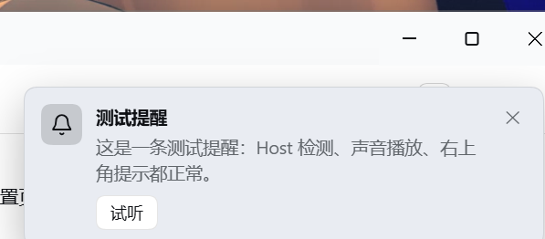

# 西北 · DSH 工作台

> **升级提醒（2026-10-21）**：`1.4.5` / `1.0.4` 因包名变更后客户端 bundle 仍注册旧 id，安装后会导致 DSH 启动失败（`web boot: entries did not activate`）。请使用 `1.4.6` / `1.0.5` 或更新版本。


两个 DeepSeek Harness（DSH）插件：**工作日志**与**任务完成提醒**。一起用就是「记录 → 派发 → 完成提醒 → 花费回看」的闭环。

## 插件

### 工作日志（Work Log）

在 DSH 左侧栏按天写总结、维护带序号的任务，一键把任务发到指定工作区的「新会话」或「已有对话」直接开始/继续工作，并按真实 token 用量粗略估算今日与单任务花费。

- 目录：[`daily-log/`](daily-log/)
- npm：`@buxihuanxibei/dsh-daily-log`
- 截图：

### 任务完成提醒（Task Done Chime）

一轮对话跑完时播放柔和的提示音（6 种），并在右上角提示是哪个会话完成，点一下即可回去。

- 目录：[`task-done-chime/`](task-done-chime/)
- npm：`@buxihuanxibei/dsh-task-done-chime`
- 截图：

## 安装

要求：DSH **0.2.1-rc.2 及以上**（Web / Desktop）。

1. DSH 侧栏 → **插件** → **安装插件**
2. 安装源填 npm 包名，或本地目录 / `.tgz` 的绝对路径：

```
@buxihuanxibei/dsh-daily-log
@buxihuanxibei/dsh-task-done-chime
```

3. 安装后重启 DSH 或等 HMR 生效，刷新页面

提示音插件需要页面加载后点击一次（浏览器自动播放策略）。

## 数据与隐私

- 日志保存在本机 `~/.dsh/plugin-data/dsh-daily-log/journal.json`，不上传
- 花费只读取本机用量账本，不修改
- 两个插件都没有遥测

## 开发与测试

工作日志：

```bash
cd daily-log
node test/render-smoke.mjs   # 渲染层冒烟测试
node test/host-routes.mjs    # Host 路由测试
```

## License

[MIT](LICENSE)
