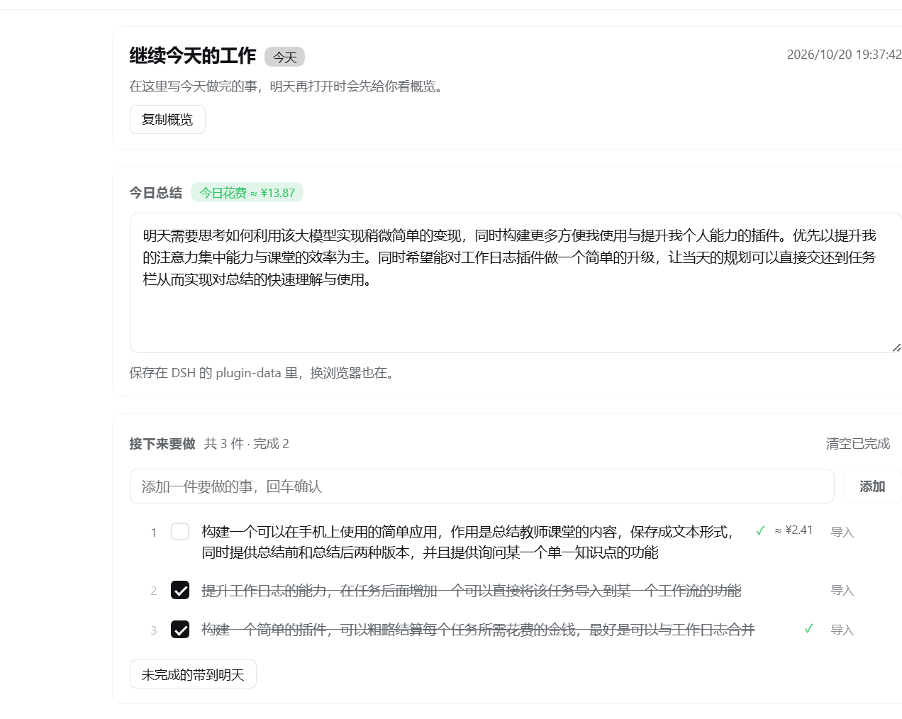

# 西北 · 工作日志（Work Log）

作者：西北。在 DSH 左侧栏写当日总结、维护带序号的任务，**一键把任务派发到工作区会话里直接开始干活**，并按真实 token 用量粗略估算**今日花费与每个任务的花费**。



## 为什么用它

- **收工前 3 分钟**：写几句总结，勾掉做完的事
- **第二天打开**：先看「欢迎回来」卡片，昨天没做完的自动列出来，可一键带到今天
- **不想复制粘贴**：点任务后的「导入」，选工作区和模式，任务直接发进会话，agent 立刻开始
- **想知道花了多少钱**：面板直接显示今日花费和每个派发任务的花费，不用去翻账单

## 功能

| 功能 | 说明 |
|---|---|
| 按天总结 | 输入停顿 0.7 秒自动保存，关面板/切走时兜底保存 |
| 任务清单 | 带序号、勾选完成、删除、清空已完成、未完成带到明天 |
| 欢迎回来 | 隔天打开先显示上次总结与未完成事项，可一键「带到今天」 |
| 一键派发 | 选择工作区 + 模式（预设），**新开会话**或**续接已有对话**，任务作为消息直接发出并切过去 |
| 花费估算 | 读当天用量账本，显示今日花费；派发过的任务显示各自花费 |
| 历史与导出 | 最近 21 天回顾；一键导出 Markdown |
| 中英双语 | 跟随 DSH 语言设置 |

## 安装

要求：DSH **0.2.1-rc.2 及以上**（Web / Desktop 均可）。

**方式一：从本地目录安装（推荐）**

1. 把本目录放到任意位置，例如 `D:\dsh-plugins\daily-log`
2. 打开 DSH 侧栏 → **插件** → **安装插件**
3. 「安装源」填该目录的**绝对路径**，确认安装
4. 安装后按提示重启 DSH（或等 HMR 生效），刷新页面

**方式二：npm 包名安装（最省事）**

DSH 插件页 → 安装插件 → 安装源填：

```
@buxihuanxibei/dsh-daily-log
```

**方式三：从压缩包安装**

把 `release/daily-log-<version>.tgz` 下载到本地，安装源填这个 `.tgz` 的绝对路径。

**方式四：让 Agent 安装（开发者）**

在 Creator 模式（创造模式）下直接对 Agent 说：

> 把 `D:\dsh-plugins\daily-log` 这个目录作为插件安装到当前 profile

## 使用

1. 左侧图标栏点「工作日志」进入面板
2. 「今日总结」里写今天做完的事（自动保存）
3. 「接下来要做」里添加任务，按回车即可
4. 想现在就做：点任务后的 **导入** → 选工作区 → 选「新开一个会话」或某个已有对话 → **开始工作**
5. 任务完成后勾掉；第二天打开会看到概览

### 花费是怎么算的（粗略）

- **今日花费**：直接读 DSH 用量账本 `~/.dsh/dsh-usage/usage-ledger.json` 里当天已按官方价算好的金额（CNY），不做二次估算
- **单任务花费**：用「当天总花费 ÷ 当天总 tokens」得到的混合单价，乘上该任务所在对话在**派发时刻之后**的 token 用量
- 只统计从工作日志派发出去的任务；同一对话在派发前的历史消耗不计入
- 账本里没有当天数据时，按 2 元/百万 tokens 兜底，并在悬浮提示里注明

> 这是"粗略结算"，用于感知成本量级，不等于账单。

## 数据与隐私

- 日志保存在本机 `~/.dsh/plugin-data/dsh-daily-log/journal.json`（原子写入），**不上传任何服务器**
- 花费读取用量账本，**只读**，不修改
- 换浏览器/清缓存不丢数据（存在 Host 侧）

## 兼容与降级

- 只依赖 DSH 的 `webServer`；`sessionQuery`、`workspaceRegistry`、`agentPresets` 为可选服务
- 缺少 `sessionQuery` 时：派发仍可用，花费与会话列表显示为空
- 缺少 `workspaceRegistry` 时：工作区下拉为空，无法派发

## 常见问题

**任务列表里没有我要的对话？**
默认只列「有名字且未归档」的对话；点下方的「显示全部」可展开未命名与已归档的会话。

**花费不显示？**
只有从工作日志派发（或记录了会话 ID）的任务才有单任务花费；今日花费需要当天用量账本里有数据。

**面板刷新后数据还在吗？**
在。数据在 Host 侧，刷新页面不影响。

## 开发与测试

```bash
# 渲染层冒烟测试（最小 React 运行时，无需浏览器）
node test/render-smoke.mjs

# Host 路由测试（临时 DSH_HOME，不碰真实数据）
node test/host-routes.mjs
```

## English

**Work Log** — a left-sidebar panel for DSH. Write a daily summary, keep numbered tasks, and dispatch any task into a new or existing workspace conversation in one click (workspace + agent preset), where it is sent immediately and work starts. It also shows a rough spend estimate for today and for each dispatched task, prorated from the real token usage ledger.

Install: DSH ≥ 0.2.1-rc.2 → Plugins → Install plugin → point the source at this directory (or the `.tgz`) → restart/reload. Data stays local under `~/.dsh/plugin-data/dsh-daily-log/`.

## License

[MIT](LICENSE)
