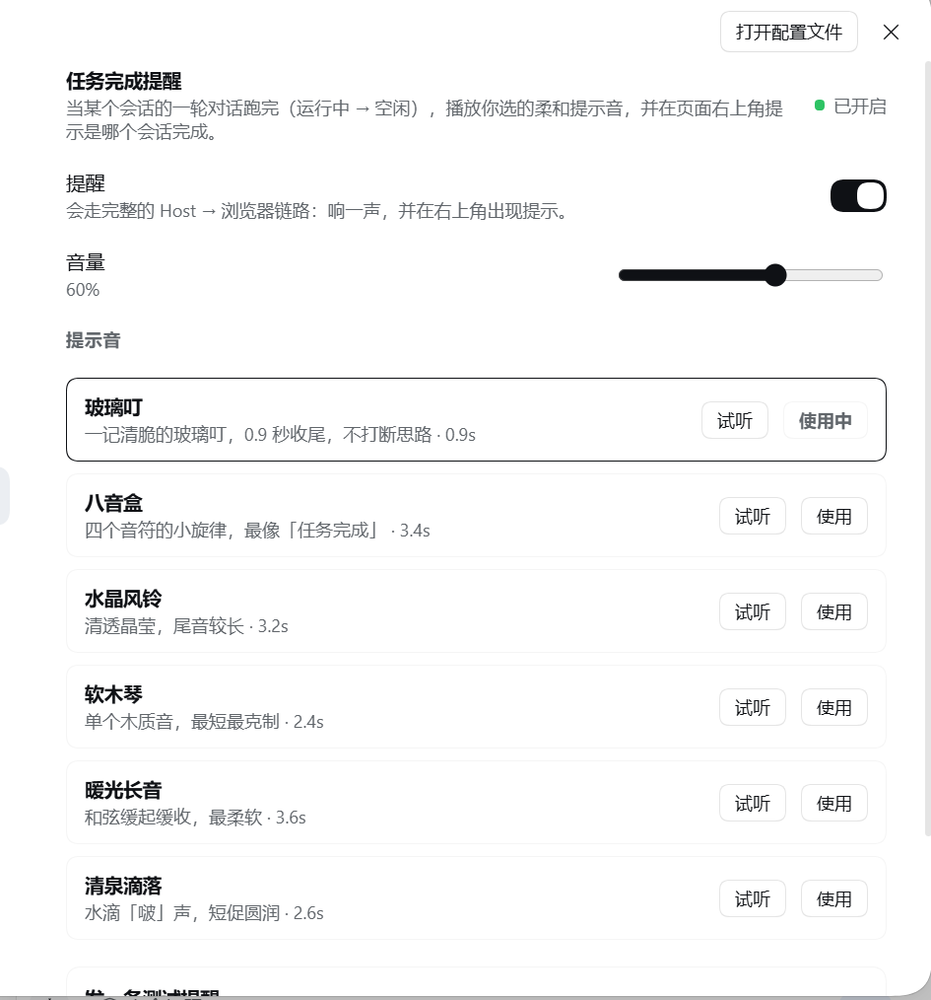

# 西北 · 任务完成提醒（Task Done Chime）

作者：西北。一轮对话跑完时，播放一声柔和的提示音，并在页面右上角告诉你**是哪个会话完成了**。

适合把任务丢给 DSH 之后去干别的事——不用一直盯着屏幕，响一声就知道可以回来了。


## 功能

| 功能 | 说明 |
|---|---|
| 6 种提示音 | 玻璃叮 / 八音盒 / 水晶风铃 / 软木琴 / 暖光长音 / 清泉滴落 |
| 完成提示 | 右上角卡片显示会话名，点「回来看看」直接跳过去 |
| 多会话 | 多个会话同时跑，任意一个完成都会提醒；同一时刻完成时合并为一次，不叠音 |
| 通知范围 | 默认只提醒主会话，子代理完成不打扰 |
| 开关与音量 | 输入框右下角铃铛可一键静音；设置页可调音量、换声音、试听 |
| 测试提醒 | 设置页「发一条测试提醒」，走完整链路验证 |



## 安装

要求：DSH **0.2.1-rc.2 及以上**（Web / Desktop 均可）。

1. 把本目录放到任意位置，例如 `D:\dsh-plugins\task-done-chime`
2. DSH 侧栏 → **插件** → **安装插件**
3. 「安装源」填目录绝对路径（或 `release/task-done-chime-<version>.tgz`）
4. 安装后重启 DSH 或等 HMR 生效，刷新页面

## 从 npm 安装（最省事）

DSH 插件页 → 安装插件 → 安装源填：

```
@buxihuanxibei/dsh-task-done-chime
```

## 使用

1. 打开一次页面后**随便点一下**（浏览器要求用户交互后才允许播放声音）
2. 把任务发给 DSH，然后去做别的事
3. 一轮结束时听到提示音，右上角出现完成卡片
4. 想立刻验证：**设置 → 任务完成提醒 → 发一条测试提醒**

## 配置（`cordis.patch.yml`）

| 字段 | 默认 | 说明 |
|---|---|---|
| `defaultSound` | `glass-ding` | 默认提示音 id |
| `announceSubagents` | `false` | 子代理会话完成是否也提醒 |
| `mergeWindowMs` | `1200` | 多个会话同时完成时的合并窗口（毫秒） |

可选 id：`glass-ding`、`music-box`、`crystal-chime`、`soft-marimba`、`warm-pad`、`water-drop`。
把自定义音频放进 `sounds/` 目录（`.wav/.mp3/.ogg/.m4a`）会自动出现在设置页里。

## 常见问题

**没有声音？**
1. 页面加载后是否点过至少一次（浏览器自动播放限制）；
2. 系统音量/输出设备是否正常，浏览器标签是否被静音；
3. 输入框右下角铃铛是否显示「提醒关」；
4. 设置页把音量拉到 100%，点「试听」确认音频链路。

**刷新页面后，刚才完成的任务没补响？**
设计如此：刷新时只提醒 8 秒内刚完成的任务，避免重放历史。

**提示音和 Toast 都没有？**
打开 `设置 → 任务完成提醒` 看是否有错误提示，或重启 DSH 后重试。

## 技术说明

- Host 侧监听会话运行状态，记录每个完成事件；浏览器通过长轮询 `/task-done-chime/feed` 取回
- 通知 id 基于时间戳，Host 重启后不会让浏览器漏掉新通知
- 音频优先走 Web Audio（解码缓存），失败时退回 `<audio>` 元素

## English

**Task Done Chime** — plays a gentle chime when a DSH conversation finishes a turn and shows which session completed in the top-right corner. Six built-in chimes, a mute toggle in the composer, volume/choice/preview in Settings, and a test reminder button.

Install: DSH ≥ 0.2.1-rc.2 → Plugins → Install plugin → point the source at this directory (or the `.tgz`). Click the page once after loading so the browser allows audio.

## License

[MIT](LICENSE)
